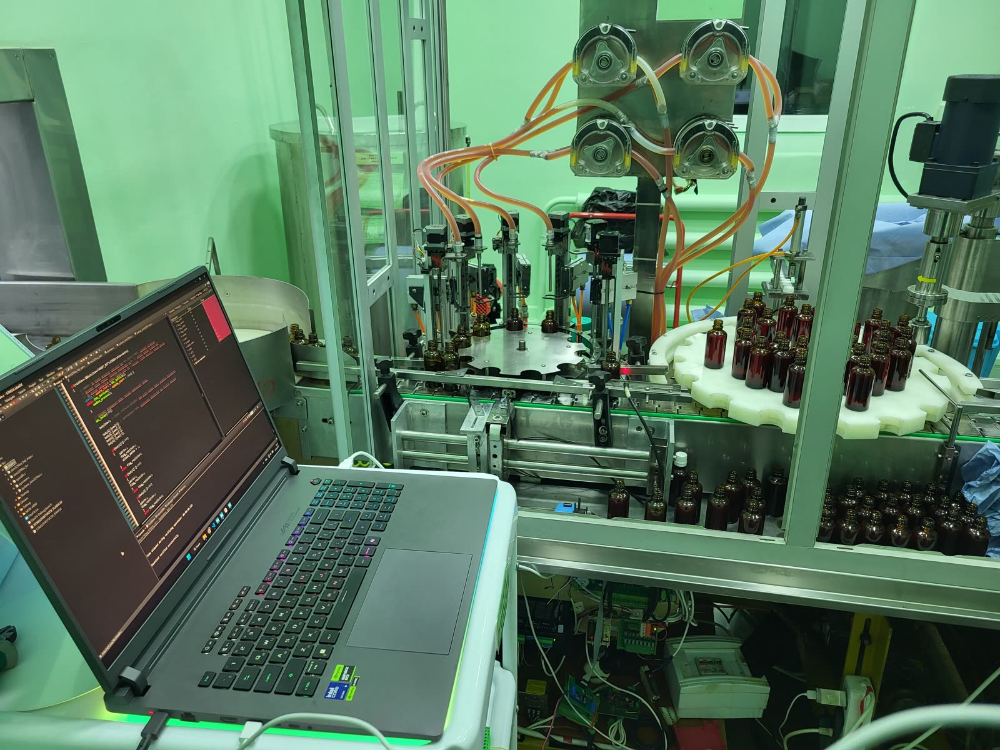
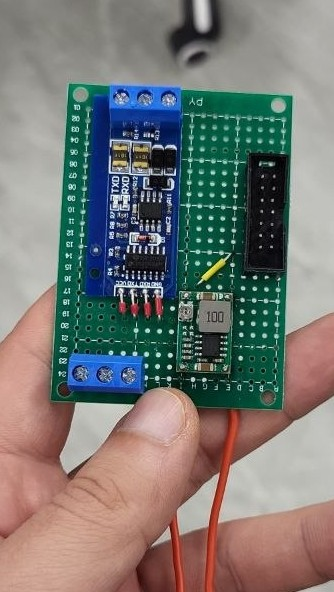

# Industrial Fill-by-Weight Line: Firmware Modernization

> Brownfield modernization of a 5-column pharmaceutical liquid filling machine.
> Replaced a blocking HX711 weighing MCU with industrial Modbus RTU indicators,
> rewrote the stepper controller firmware with a dedicated Modbus state machine
> and a new weight-tracking fill algorithm.
>
> **Result: throughput 480 → 650 bottles/hour (+35 %), overfill rejects
> reduced, calibration moved from an in-firmware menu to standard operator
> buttons on each weighing indicator.**

**Role:** sole embedded engineer (firmware, RS-485/UART adapter shield, field
integration, operator-side provisioning).
**Timeline:** 3 weeks on a dedicated test rig · 2 days on-site integration ·
3 months of field iterations in production.
**Industry:** industrial liquid filling, pharmaceutical production line.
**MCU:** STM32F407VG (STM32F4 Discovery), bare-metal + HAL, STM32CubeIDE.

---

## 1. The machine, in one picture



A rotating drum presents empty bottles to 5 nozzle columns. Each column has:

- a peristaltic pump driven by a stepper motor,
- a nozzle head on a vertical stepper axis (down into the bottle neck, up to
  clear it),
- a load cell under the bottle, read by a weighing indicator.

A separate stepper drives the drum. One MCU on a Darlington-array shield
controls all steppers. Weighing data comes in over a serial link.

Single fill cycle (nozzle down → soft start → fast fill → slow finish → nozzle up):

<video src="docs/videos/single_fill.mp4" controls width="640"></video>

A longer continuous run of the line in operation:

<video src="docs/videos/fill_cycle.mp4" controls width="640"></video>

> If your Markdown viewer does not render HTML `<video>`, open the files
> directly: [`single_fill.mp4`](docs/videos/single_fill.mp4) ·
> [`fill_cycle.mp4`](docs/videos/fill_cycle.mp4).

## 2. What I changed, at a glance

| | Legacy (2021) | Final (this project) |
|---|---|---|
| Weighing front-end | Custom PCB with 5× HX711, bit-banged by STM32F1 | 5× QLST industrial indicators on an RS-485 Modbus RTU bus (addresses 1..5, 115 200 bps) |
| Weighing MCU | Dedicated board, blocking `while(1)` polling | **Removed**: one MCU less, one PCB less, one ribbon cable less |
| Bus wiring | Parallel ribbon to the HX711 board | 2-wire RS-485 differential, add a sensor by chaining |
| Calibration | 2 buttons + 16×2 LCD on the hidden PCB | Buttons + display on each QLST indicator: operator-serviceable |
| MCU → MCU link | Original cable from the HX711 board | Custom RS-485↔UART shield that **re-uses the existing cable connector** on the stepper board (no changes to that PCB) |
| HMI link | Long UART cable to a Raspberry Pi | USB CDC: single cable, standard VCP driver |
| Firmware structure | Entire application inside TIM6 ISR; drum, nozzles, pumps and sensing all competing in one 10 kHz interrupt | TIM6 ISR owns timing-critical motion; the drum-position event is caught by its own EXTI line (decoupled from the 10 kHz tick); Modbus runs as a non-blocking state machine driven from the main loop with IT-based byte RX |
| Fill control | Bang-bang: pump on if `g < target − 10`, off at `target − 1.5` | Soft start → fast fill → nozzle rises proportionally to current mass → slow finish → drip tail → hard stop |
| Throughput | **480 bottles/hour** | **650 bottles/hour (+35 %)** |

Architecture diagrams: see [`docs/architecture.md`](docs/architecture.md).

### Development process (not a release train)

The firmware under `firmware/` is the single deployed version. Some
sub-features, for example moving the drum-position event onto its own EXTI
line, decoupled from the 10 kHz TIM6 tick, were first prototyped on a
side configuration before being merged into the production firmware. That
side configuration is not part of this repository; it existed only as a
local experiment.

## 3. Why this is a modernization, not a rewrite

The mechanical frame, drum, nozzle axes, pumps and the stepper controller PCB
(a carrier board with Darlington array + industrial step/dir drivers) were
all designed and built by the previous engineer years earlier. I kept them.

What I replaced is the entire weighing/sensing chain, the inter-MCU
communication, the HMI link, the firmware architecture of the stepper board,
and the fill control algorithm. The custom HX711 board and its firmware are
gone from the installed machine.

The previous engineer kindly shared his sources and schematics for reference.
**None of his code or schematics are included in this repository.** The
"before" picture in this README and in [`docs/architecture.md`](docs/architecture.md)
is my own architectural description based on reading his sources and operating
the deployed machine; it does not reproduce his design files.

## 4. The three months in the field

The real story is not the architecture: it's what happened once the machine
had to run bottles every day. Compressed version:

- hacking an existing HX711 pin to carry UART before committing to the shield;
- bringing the Modbus bus up to 115 200 bps + 40 Hz indicator refresh when the
  5th column was added for throughput;
- discovering corrosion on reused loom connectors after 6 weeks;
- rebuilding the harness with ferrules, snap-off plugs and a twisted pair for
  Modbus (shield drain to the PG pin on each indicator, common ground back to
  the shield board);
- discovering mechanical cross-talk (the nozzle touching the bottle rim, the
  load cell touching the drum carrier) that was corrupting the weight signal.

Week-by-week log with root causes and fixes:
[`docs/field-notes.md`](docs/field-notes.md).

## 5. Fill algorithm (the part that moved the numbers)

Dose profile is parameterised in deci-grams against a 93 g reference dose.
Nozzle height is a function of current fill mass, not of time: the nozzle
sits low until the liquid surface comes up to meet it, then rises
proportionally so the stream never free-falls more than ~5 mm. Pump speed has
four phases: `SOFT_START → FAST → SLOW → DRIP_TAIL`, each driven by a
TIM6-tick counter inside the ISR.

Full write-up with annotated code excerpts:
[`docs/fill-algorithm.md`](docs/fill-algorithm.md).

## 6. Modbus RTU master

Non-blocking state machine (`MODBUS_IDLE → WAIT_RESPONSE`) driven from the
main loop, byte-level RX via `HAL_UART_Receive_IT`, CRC16 verification before
accepting a sample. On error (framing, overrun, CRC, timeout) the master
aborts and advances to the next slave on the next tick, so one bad indicator
never stalls the other four.

QLST register map, timing, and error handling:
[`docs/modbus.md`](docs/modbus.md).

## 7. RS-485↔UART shield (my hardware contribution)



Prototype on a green proto-board. The original 2021 ribbon cable from the
HX711 PCB terminates into the stepper board's existing connector; I identified
the two pins carrying the HX711 CLK/DATA signals on that connector, re-purposed
them as UART TX/RX, and routed them into a MAX485-class transceiver with DE/RE
driven in software. This way **the stepper PCB is physically unmodified**.
Pull the shield, plug the old HX711 board back in, and the machine reverts
to the previous configuration.

Pinout, transceiver, EMI countermeasures and what I'd do with another
revision: [`docs/shield.md`](docs/shield.md).

## 8. What I would do differently next time

- Split NVIC priorities properly: group drum stepping at a higher preemption
  priority than USART2 RX, instead of leaning on the state machine to keep
  them from fighting (both are currently at priority 0/0, and it works, but it is
  fragile).
- Isolated DC-DC + reference ground on the RS-485 side, instead of a shared
  ground over an 80 cm run. I knew this at the time; the isolated converter
  was simply not procurable locally within the project schedule.
- Move the fill parameters into a small persistent config block (flash
  parameter page) instead of compile-time `#define`s, so a dose change
  does not require re-flashing.
- Replace per-column copy-pasted logic with a `fill_column_t` struct and a
  single state function.

## 9. A note on the firmware snapshot

The sources placed under `firmware/` are the closest snapshot of the production
firmware I have local access to. The actually-deployed build differs in one
specific area: the interrupt configuration (NVIC priorities and the
split between the TIM6 motion tick and the drum-position event) matches a
side configuration I used to prototype that split before merging it back
into the main firmware. The business logic (Modbus RTU master, USB CDC
HMI link, fill algorithm with soft-start and nozzle tracking, drum / nozzle /
pump motion) is the same between the snapshot in this repo and the
deployed build.

I have called this out explicitly rather than silently publishing the
snapshot as "the deployed firmware", because on an interview that
distinction is the kind of thing that would come up and should come up.

## 10. Repository layout

```
.
├── README.md: you are here
├── README.ru.md: Russian version
├── LICENSE: MIT (my sources only)
├── docs/
│   ├── architecture.md: before / after block diagrams (Mermaid)
│   ├── fill-algorithm.md: dose profile, nozzle tracking, pump phases
│   ├── modbus.md: QLST register map, state machine, timing
│   ├── shield.md: RS-485↔UART adapter board
│   ├── legacy.md: what the previous system looked like (my words)
│   ├── field-notes.md: three months of field debugging
│   ├── images/: photos
│   └── videos/: short clips (single_fill.mp4)
└── firmware/: closest snapshot of the production firmware (STM32F4)
```

## 11. Disclaimers

This repository documents a modernization I performed on a pre-existing
industrial machine. The customer, product and plant are not identified. No
third-party source code, schematics, Gerbers or internal documents are
reproduced. The vendor manual for the QLST weighing indicators is the
property of the manufacturer and is not included; see the manufacturer's
site for the current document.
