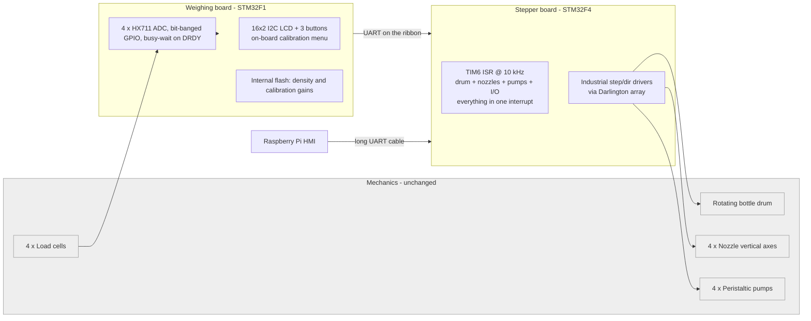
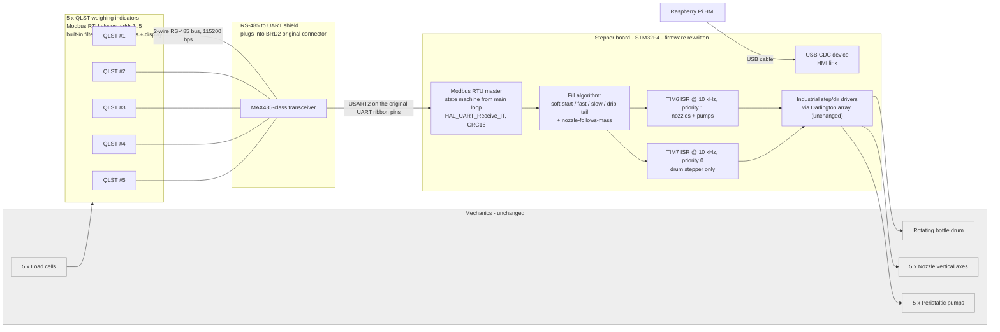

# Industrial Fill-by-Weight Line: Firmware Modernization

> Brownfield modernization of a 5-column pharmaceutical liquid filling machine.
> Replaced a blocking HX711 weighing MCU with industrial Modbus RTU indicators,
> rewrote the stepper controller firmware with a dedicated Modbus state machine
> and a new weight-tracking fill algorithm.
>
> **Result: throughput 480 → 650 bottles/hour (+35 %), overfill rejects
> reduced, calibration moved from an in-firmware menu to standard operator
> buttons on each weighing indicator.**

**Role:** sole embedded engineer (firmware, RS-485/UART adapter shield, field
integration, operator-side provisioning).
**Timeline:** 3 weeks on a dedicated test rig · 2 days on-site integration ·
3 months of field iterations in production.
**Industry:** industrial liquid filling, pharmaceutical production line.
**MCU:** STM32F407VG (STM32F4 Discovery), bare-metal + HAL, STM32CubeIDE.

---

## 1. The machine, in one picture


A rotating drum presents empty bottles to 5 nozzle columns. Each column has:

- a peristaltic pump driven by a stepper motor,
- a nozzle head on a vertical stepper axis (down into the bottle neck, up to
  clear it),
- a load cell under the bottle, read by a weighing indicator.

A separate stepper drives the drum. One MCU on a Darlington-array shield
controls all steppers. Weighing data comes in over a serial link.

A longer continuous run of the line in operation:

<video src="docs/videos/fill_cycle.mp4" controls width="640"></video>

Single fill cycle (nozzle down → soft start → fast fill → slow finish → nozzle up):

<video src="docs/videos/single_fill.mp4" controls width="640"></video>

> If your Markdown viewer does not render HTML `<video>`, open the files
> directly: [`single_fill.mp4`](docs/videos/single_fill.mp4) ·
> [`fill_cycle.mp4`](docs/videos/fill_cycle.mp4).

## 2. What I changed, at a glance

| | Legacy (2021) | Final (this project) |
|---|---|---|
| Weighing front-end | Custom PCB with 4× HX711, bit-banged by STM32F1 | 5× QLST industrial indicators on an RS-485 Modbus RTU bus (addresses 1..5, 115 200 bps) |
| Weighing MCU | Dedicated board, blocking `while(1)` polling | **Removed**: one MCU less, one PCB less |
| Link between boards | UART already present on the ribbon from the stepper board to the weighing board | Same UART pins, now into a custom RS-485 shield on that connector (stepper PCB unchanged) |
| Calibration | 2 buttons + 16×2 LCD on the hidden PCB | Buttons + display on each QLST indicator: operator-serviceable |
| Scale bus | None: each HX711 was bit-banged on the weighing board | 2-wire RS-485, extra sensor by chaining |
| HMI link | Long UART cable to a Raspberry Pi | USB CDC: single cable, standard VCP driver |
| Firmware structure | Entire application inside TIM6 ISR; drum, nozzles, pumps and sensing all competing in one 10 kHz interrupt | TIM7 steps the drum at priority 0; TIM6 (priority 1) owns nozzles, pumps and bottle counting; USART2 (priority 0) receives Modbus one byte at a time; the fill state machine runs from the main loop |
| Fill control | Bang-bang: pump on if `g < target − 10`, off at `target − 1.5` | Soft start → fast fill → nozzle rises proportionally to current mass → slow finish → drip tail → hard stop |
| Throughput | **480 bottles/hour** | **650 bottles/hour (+35 %)** |

## Architecture

The drum, nozzle axes, pumps and load cells stayed. The fifth column was
added during this retrofit, so the first diagram has four stations and the
second has five. Longer notes: [`docs/architecture.md`](docs/architecture.md).

### Before: 2021



Four HX711 channels were bit-banged in a blocking loop on a second MCU.
Weights crossed the ribbon as UART. Drum, nozzles, pumps and inputs all
shared one 10 kHz TIM6 interrupt.

### After: this firmware



The weighing board is gone. Five indicators sit on one RS-485 bus. The
shield plugs into the same ribbon connector and uses the UART pins that
used to talk to that board. TIM7 steps the drum at NVIC priority 0. TIM6,
at priority 1, drives nozzles and pumps. USART2, also priority 0, receives
Modbus one byte at a time.

| Peripheral | Config | Purpose |
|---|---|---|
| TIM7 | 10 kHz, NVIC priority 0 | drum stepper only (PC6 enable, PC7 step) |
| TIM6 | 10 kHz, NVIC priority 1 | nozzles, pumps, bottle counting, USB CDC TX |
| USART2 PA2/PA3 | 115 200 8N1, RX IT, priority 0 | Modbus RTU master to the QLST bus |
| USB_OTG_FS | CDC | HMI link to the Raspberry Pi |

### Development process (not a release train)

The firmware under `firmware/` is one tree. Drum stepping lives in TIM7,
nozzles and pumps stay in TIM6, and Modbus reception stays in USART2.
A side experiment was used to split the drum out of TIM6; that experiment
is not in the repository. Its interrupt layout is what this tree uses.

## 3. Why this is a modernization, not a rewrite

The mechanical frame, drum, nozzle axes, pumps and the stepper controller PCB
(a carrier board with Darlington array + industrial step/dir drivers) were
all designed and built by the previous engineer years earlier. I kept them.

What I replaced is the entire weighing/sensing chain, the inter-MCU
communication, the HMI link, the firmware architecture of the stepper board,
and the fill control algorithm. The custom HX711 board and its firmware are
gone from the installed machine.

The previous engineer kindly shared his sources and schematics for reference.
**None of his code or schematics are included in this repository.** The
"before" picture in this README and in [`docs/architecture.md`](docs/architecture.md)
is my own architectural description based on reading his sources and operating
the deployed machine; it does not reproduce his design files.

## 4. The three months in the field

The real story is not the architecture: it's what happened once the machine
had to run bottles every day. Compressed version:

- keeping the weighing board at first by unsoldering one HX711 and using its two UART-capable pins; that path glitched, so the board was removed and the existing UART ribbon was reused for the shield;
- bringing the Modbus bus up to 115 200 bps + 40 Hz indicator refresh when the
  5th column was added for throughput;
- discovering corrosion on reused loom connectors after 6 weeks;
- rebuilding the harness with ferrules, snap-off plugs and a twisted pair for
  Modbus (shield drain to the PG pin on each indicator, common ground back to
  the shield board);
- discovering mechanical cross-talk (the nozzle touching the bottle rim, the
  load cell touching the drum carrier) that was corrupting the weight signal.

Week-by-week log with root causes and fixes:
[`docs/field-notes.md`](docs/field-notes.md).

## 5. Fill algorithm (the part that moved the numbers)

Dose profile is parameterised in deci-grams against a 93 g reference dose.
Nozzle height is a function of current fill mass, not of time: the nozzle
sits low until the liquid surface comes up to meet it, then rises
proportionally so the stream never free-falls more than ~5 mm. Pump speed has
four phases: `SOFT_START → FAST → SLOW → DRIP_TAIL`, each driven by a
TIM6-tick counter inside the ISR.

Full write-up with annotated code excerpts:
[`docs/fill-algorithm.md`](docs/fill-algorithm.md).

## 6. Modbus RTU master

Non-blocking state machine (`MODBUS_IDLE → WAIT_RESPONSE`) driven from the
main loop, byte-level RX via `HAL_UART_Receive_IT`, CRC16 verification before
accepting a sample. On error (framing, overrun, CRC, timeout) the master
aborts and advances to the next slave on the next tick, so one bad indicator
never stalls the other four.

QLST register map, timing, and error handling:
[`docs/modbus.md`](docs/modbus.md).

## 7. RS-485↔UART shield (my hardware contribution)


Prototype on a green proto-board. The ribbon from the stepper board to the
old weighing board already carried UART between the two MCUs. The shield
plugs into that same connector and routes those UART pins into a MAX485-class
transceiver. The stepper PCB is physically unmodified. Pull the shield, plug
the old weighing-board ribbon back in, and the machine reverts to the previous
configuration.

Pinout, transceiver, EMI countermeasures and what I'd do with another
revision: [`docs/shield.md`](docs/shield.md).

## 8. What I would do differently next time

- Give TIM7 a strictly higher preemption priority than USART2 if a long
  Modbus receive ISR ever stretches a drum step. Today they share priority 0,
  and TIM6 (nozzles and pumps) sits at priority 1 so it cannot preempt either.
- Isolated DC-DC + reference ground on the RS-485 side, instead of a shared
  ground over an 80 cm run. I knew this at the time; the isolated converter
  was simply not procurable locally within the project schedule.
- Move the fill parameters into a small persistent config block (flash
  parameter page) instead of compile-time `#define`s, so a dose change
  does not require re-flashing.
- Replace per-column copy-pasted logic with a `fill_column_t` struct and a
  single state function.

## 9. A note on the firmware sources

`firmware/` is the production source as reconstructed on this machine.
The fill algorithm, USB CDC link and Modbus master come from the firmware
that ran the line. Drum stepping was still inside TIM6 in that copy. The
separate drum interrupt (TIM7 at priority 0, TIM6 dropped to priority 1,
USART2 left at priority 0) was proven on a side experiment and is now in
this tree. The hex last flashed on the machine is not stored here.

## 10. Repository layout

```
.
├── README.md: you are here
├── LICENSE: MIT (my sources only)
├── docs/
│   ├── architecture.md: same diagrams as above, plus the pain points in prose
│   ├── fill-algorithm.md: dose profile, nozzle tracking, pump phases
│   ├── modbus.md: QLST register map, state machine, timing
│   ├── shield.md: RS-485↔UART adapter board
│   ├── legacy.md: what the previous system looked like (my words)
│   ├── field-notes.md: three months of field debugging
│   ├── images/: photos
│   └── videos/: short clips (single_fill.mp4)
└── firmware/: production firmware sources (STM32F4)
```

## 11. Disclaimers

This repository documents a modernization I performed on a pre-existing
industrial machine. The customer, product and plant are not identified. No
third-party source code, schematics, Gerbers or internal documents are
reproduced. The vendor manual for the QLST weighing indicators is the
property of the manufacturer and is not included; see the manufacturer's
site for the current document.
