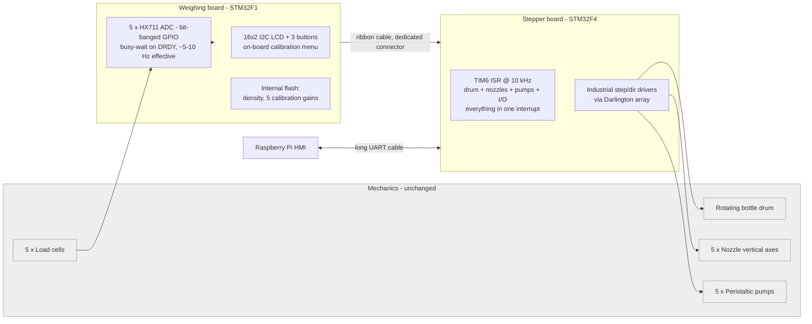
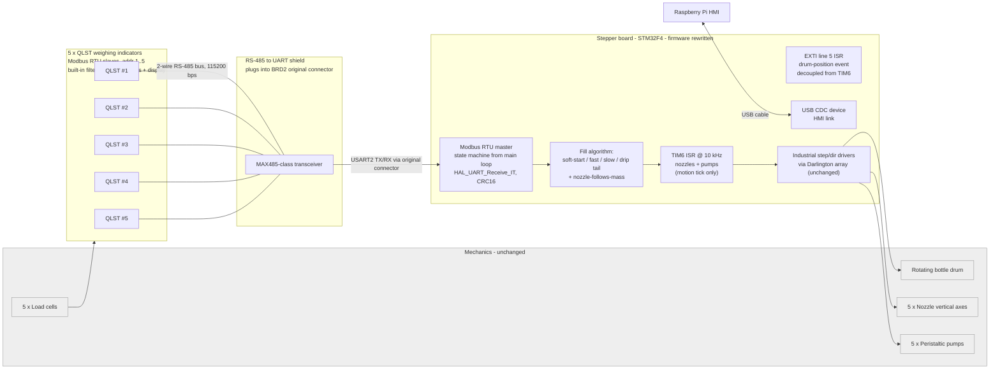

# Architecture: before and after

Both diagrams describe the deployed machine from the electrical / firmware
side. Mechanics (drum, nozzle axes, pumps, load cells) are unchanged between
the two versions and are drawn in grey.

## Before: 2021 system

Pain points this hardware configuration created:

1. **HX711 polling blocks everything on BRD1.** Each `Hx_Read_N()` is a GPIO
   bit-bang with a busy-wait on DRDY and a 1-million-iteration safety loop.
   Five of these in a row inside `while(1)`, plus a trailing `HAL_Delay(100)`,
   gives an effective sample rate in the single-digit Hz range.
2. **No bus: a parallel ribbon.** Adding a sensor meant more wires and more
   pins; the connector was already full.
3. **Calibration hidden inside the enclosure.** The LCD and buttons sat on
   BRD1, which was mounted behind panels. Re-calibration meant opening the
   machine.
4. **BRD2 ISR did everything.** Drum stepping, nozzle up/down, pump pulses
   and input polling all shared one 10 kHz TIM6 interrupt. There was no room
   to add non-trivial sensing without hurting drum motion.

## After: current system

What the new picture is doing differently:

1. **Weighing is now a bus device, not a bit-banged peripheral.** QLST
   indicators run their own filter at ~40 Hz, timestamp-stable samples arrive
   over Modbus RTU; the stepper MCU just asks and waits with a timeout.
2. **BRD1 is gone.** One less PCB, one less MCU, one less failure point. The
   calibration UI is now on each QLST unit, which the plant operator can
   handle without opening the machine.
3. **Reversible retrofit.** The shield plugs into the existing BRD2 connector
   that used to carry the HX711-side ribbon. Pull the shield, plug the old
   BRD1 ribbon back in: the machine is in the previous configuration.
4. **ISRs are specialised.** TIM6 drives the periodic motion tick (nozzle
   axes, pump pulsing, bottle counting). The drum-position event has been
   moved onto its own EXTI line, so it is no longer polled inside TIM6 at
   10 kHz and no longer competes with the motion tick. Modbus RX runs in the
   USART2 IRQ byte-by-byte, and fill-state logic plus USB CDC run from the
   main loop.

## MCU resources (current firmware)

| Peripheral | Config | Purpose |
|---|---|---|
| TIM6 | prescaler 167, period 99 → 10 kHz, update IRQ | motion tick: nozzle axes, pump pulsing, bottle counting |
| EXTI line 5 | GPIO interrupt | drum-related event, decoupled from the TIM6 motion tick |
| USART2 (PA2/PA3) | 115 200 8N1, async, RX IT per byte | Modbus RTU master link to QLST bus |
| USB_OTG_FS (PA11/PA12) | USB device, CDC class | HMI link to Raspberry Pi (replaces long UART) |
| GPIO | ~30 lines on A/B/C/D/E | step/dir/enable to Darlington array, end-switches, operator buttons |

NVIC: `TIM6_DAC_IRQn`, `USART2_IRQn` and `EXTI9_5_IRQn` are all at preemption
0 / subpriority 0 in the current build. Interaction between the motion tick,
the drum event and the Modbus RX is handled by the firmware state machines
instead of hardware preemption. This is called out in the "what I'd do
differently" section of the main README.
