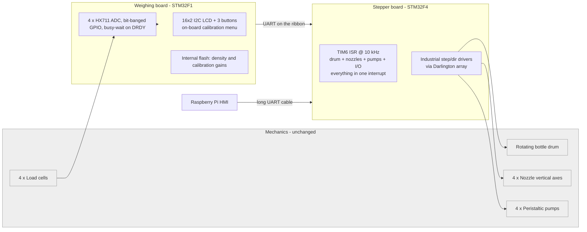
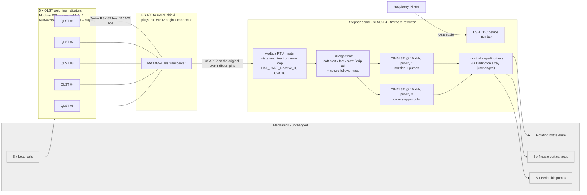

# Architecture: before and after

The same diagrams are on the repository front page, in [`README.md`](../README.md).

Both diagrams describe the machine from the electrical and firmware side.
The drum, nozzle axes, pumps, and load cells are drawn in grey. The fifth
column was added during this retrofit, so the "before" picture has four
stations and the "after" picture has five.

## Before: 2021 system

Pain points this hardware configuration created:

1. **HX711 polling blocks everything on BRD1.** Each `Hx_Read_N()` is a GPIO
   bit-bang with a busy-wait on DRDY and a 1-million-iteration safety loop.
   Four of these in a row inside `while(1)`, plus a trailing `HAL_Delay(100)`,
   gives an effective sample rate in the single-digit Hz range.
2. **The ribbon was already UART, not a scale bus.** The two boards talked
   over UART on that cable. Adding a scale still meant another HX711 and
   another blocking read on BRD1. The shield later reused those same UART pins.
3. **Calibration hidden inside the enclosure.** The LCD and buttons sat on
   BRD1, which was mounted behind panels. Re-calibration meant opening the
   machine.
4. **BRD2 ISR did everything.** Drum stepping, nozzle up/down, pump pulses
   and input polling all shared one 10 kHz TIM6 interrupt. There was no room
   to add non-trivial sensing without hurting drum motion.

## After: current system

What the new picture is doing differently:

1. **Weighing is now a bus device, not a bit-banged peripheral.** QLST
   indicators run their own filter at ~40 Hz, timestamp-stable samples arrive
   over Modbus RTU; the stepper MCU just asks and waits with a timeout.
2. **BRD1 is gone.** One less PCB, one less MCU, one less failure point. The
   calibration UI is now on each QLST unit, which the plant operator can
   handle without opening the machine.
3. **Reversible retrofit.** The shield plugs into the existing BRD2 connector
   whose ribbon used to carry UART to the weighing board. Pull the shield,
   plug the old BRD1 ribbon back in: the machine is in the previous configuration.
4. **ISRs are specialised.** TIM7 steps the drum at NVIC priority 0.
   TIM6, at priority 1, drives nozzles, pumps and bottle counting, so a
   long nozzle pass cannot stretch a drum step. USART2 sits at priority 0
   with TIM7 and receives Modbus one byte at a time. Fill-state logic and
   USB CDC run from the main loop.

## MCU resources (current firmware)

| Peripheral | Config | Purpose |
|---|---|---|
| TIM7 | prescaler 167, period 99 → 10 kHz, update IRQ, NVIC priority 0 | drum stepper only (PC6 enable, PC7 step) |
| TIM6 | prescaler 167, period 99 → 10 kHz, update IRQ, NVIC priority 1 | nozzles, pump pulsing, bottle counting, USB CDC background TX |
| USART2 (PA2/PA3) | 115 200 8N1, async, RX IT per byte, NVIC priority 0 | Modbus RTU master link to QLST bus |
| USB_OTG_FS (PA11/PA12) | USB device, CDC class | HMI link to Raspberry Pi (replaces long UART) |
| GPIO | ~30 lines on A/B/C/D/E | step/dir/enable to Darlington array, end-switches, operator buttons |

NVIC: `TIM7_IRQn` and `USART2_IRQn` are preemption 0. `TIM6_DAC_IRQn` is
preemption 1, so nozzle and pump work cannot preempt a drum step or a
Modbus byte. TIM7 and USART2 share a level, so they do not nest in each
other.
