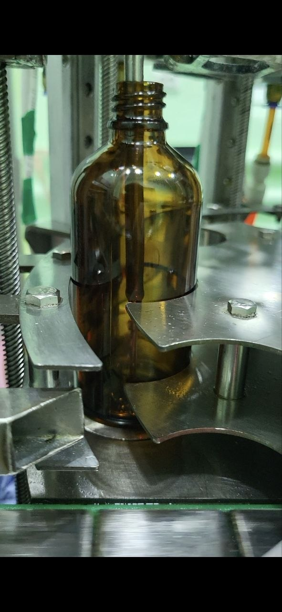

# Three months in the field

> This is the honest log of how a bench-ready firmware became a line-ready
> firmware. The architecture pieces (shield, Modbus, fill algorithm) are
> documented separately. What follows is the story of how each of them
> actually earned its place on a production machine.

**Timeline summary**

| Phase | Duration | Where |
|---|---|---|
| Build a dedicated test rig, bring up Modbus, prototype the fill algorithm | 3 weeks | my bench |
| On-site integration | 2 days | on the line |
| Field iterations, in service, with bottles going out the door | 3 months | on the line |

## Week 1: try to keep BRD1

The cheapest path on paper was to keep the legacy weighing board (BRD1)
and bolt Modbus onto it, so the plant would see one small change instead
of a whole missing PCB. On the shared schematic I noticed that on one of
the five HX711 channels, the two pins used for CLK/DATA on the MCU side
mapped to UART-capable alternate-function pins. I unsoldered that HX711
chip, soldered flying leads to its pads, re-mapped the pins in firmware
to UART, and ran a cable from BRD1 to one QLST indicator over RS-485.

It worked. **But it had jitter, late weights and intermittent overfill.**
BRD1's main loop was still doing blocking HX711 reads on the other four
channels, and the new UART traffic shared time with those busy-waits.
Dropping BRD1 entirely was the correct call, not a bolt-on.

**Lesson:** the "minimum-change" refactor is the wrong instinct when the
thing you're trying to keep is itself the bottleneck.

## Weeks 2–3: the shield on a protoboard

Moved to the real plan: throw out BRD1, build an adapter shield that plugs
into the same ribbon connector on BRD2. Identified the two pins on BRD2's
connector that mapped to USART-capable alternate functions. Wired a
MAX485-class transceiver and a small step-down into a green protoboard
([`shield.md`](shield.md)). Routed those two pins through the shield to
the transceiver, then to the QLST bus.

Fill quality improved immediately: because now BRD2 was asking the QLSTs
directly instead of waiting on BRD1's dying busy-waits.

## Week 4: the fifth column

Two weeks into deployment, the plant asked for a fifth filling column to
raise throughput. One more QLST on the Modbus bus. One more flag/updown/
counter block in the firmware. Mechanical install was fast; the firmware
side exposed a hidden assumption.

**Symptom:** at the previous Modbus baud (default) and the previous QLST
indicator refresh rate, polling five sensors instead of four pushed the
per-sensor sample interval over the fill algorithm's useful window. We
started seeing intermittent overfill and underfill.

**Fix:** bumped the whole bus to **115 200 bps** and raised the QLST
indicators' internal update rate to **40 Hz**. Fill accuracy came back.

**Lesson:** write down the sensor-bandwidth assumption your control loop
depends on. "It works at 4 columns" is not the same as "it will work at
N columns".

## Weeks 5–7: corrosion

Three weeks of good operation, then a slow drift: occasional missed
bottles, occasional under-fills. For another two weeks these were patched
with filters and extra sanity flags in the firmware (binary flashes over
USB: see "USB CDC HMI" below), on the assumption that it was software.

It wasn't. On a service visit I opened the panel and found green
corrosion on reused loom connectors, with several conductors held in only
by their insulation. The intermittent errors were electrical. The twisted
pair was fine; the terminations were not.

**Fix (round 1):** full re-termination with higher-grade cable.

Problem reduced but not gone: rare bus errors continued. We tolerated
these for ~3 weeks because the filters in firmware absorbed them. Then
plant was closed for a scheduled holiday; the firmware situation froze
there.

**Lesson:** don't mask hardware-root-cause issues with firmware filters,
or you will drag the hardware fault forward in time. The firmware filters
helped, but they also stopped the error from screaming loud enough to
make us open the panel earlier.

## Weeks 8–10: the comission visit

Back from the holiday. Pushed one more binary that added more flags and
checks. The plant had a comission inspection scheduled for that week and
they passed it. Good news; bad news is the error population crept back
over the next few weeks and I had to come back on site.

On that visit I found two mechanical problems that had been invisible to
me and to the operator:

1. **The nozzle was touching the bottle on descent.** Not every time.
   It depended on bottle shimming, but when it happened, it pushed on the
   bottle, which pushed on the load cell, which gave a false "there is
   mass" reading before anything was poured. I noticed it almost by
   accident while watching a bottle enter the station.
2. **The load cell carrier was grazing the drum carrier plate** on
   rotation. Enough contact to spike the weight reading by tens of
   decigrams at the moment the drum stepped. The spike coincided with
   the fill start, so the algorithm "saw" mass that was not there and
   either armed the pump at the wrong time or latched the dose early.

**Fix:** mechanical shim on the carrier (not my scope) + a weight-arm
gate in firmware (`fill_arm_dg` and `d > (spusk − 10)`). The pump cannot
start until mass has actually risen AND the nozzle axis is at the bottom
end of travel). That's the pre-arm interlock documented in
[`fill-algorithm.md`](fill-algorithm.md).

**Lesson:** when debugging a weighing system, go stand next to it and
watch one bottle go through, from start to finish. Twice. The second
time, watch the mechanical interfaces, not the display.

## Weeks 11–12: the loom, properly this time

Replaced the entire loom from the shield to each of the five indicators:

- twisted pair for A/B of the RS-485 bus;
- drain wire bonded to the **PG** pin on each QLST;
- all QLST grounds commoned at the shield board (single-point reference);
- **ferrules** on every terminal insertion;
- **snap-off plug connectors** at each column so plant electricians can
  disconnect one station without a screwdriver.

Rare bus errors reduced to effectively zero over the following week of
observation.

Noted for a future hardware revision: proper **isolated DC-DC** on the
RS-485 side and a galvanic-isolated transceiver (ISO3082 or similar) would
make the ground scheme bulletproof. I knew that at the time; the isolated
converter was simply not procurable locally within the project schedule.
The twisted-pair + drain + single-point ground is the "best you can do
without isolation" and it has held so far.

## Weeks 13+: the fill algorithm

With the sensor path clean and the mechanical cross-talk gone, the fill
behaviour was now limited by the control strategy itself, not by signal
quality. The old bang-bang left splash on the bottle neck that forced a
conservative dwell before the drum rotation. Replacing it with the
four-phase pump profile and the nozzle-follows-mass trajectory lifted
throughput from **480 to 650 bottles / hour** with no mechanical changes.
See [`fill-algorithm.md`](fill-algorithm.md) for the details.

## The reg-0x12 incident

Separate from the chronology but worth calling out: at one point the
operator-tare path was wired to QLST register **0x12** (zero calibration),
not **0x11** (peeling). Those two sound similar but do very different
things:

- `0x11 ← 1` zeroes the current displayed weight for a clean net reading.
  It is a runtime operation and does not touch the sensor calibration.
- `0x12 ← 1` **rewrites the zero constant in the indicator's EEPROM.**
  It is a one-time factory operation. Firing it on every bottle tare
  destroys the calibration and drifts the whole channel.

The symptom was slow, cumulative calibration drift across all five
channels, none individually bad enough to cross the overfill alarm, but
all five creeping together. Caught by comparing the on-indicator
calibration constants before and after a shift. The fix is a two-line
change in firmware; the lesson is "read the register map carefully for
destructive writes before you ship a tare path." The comment in
[`main.c` around line 714](../firmware/Core/Src/main.c) preserves the
original dangerous line next to the corrected one so this specific
mistake is a visible reminder.

## USB CDC HMI: the Raspberry Pi link

The original 2021 system had a long UART cable running from BRD2 to a
Raspberry Pi that acted as the HMI. Long UART over factory noise is a
bad combination. I replaced it with USB CDC on BRD2: standard VCP driver
on the Pi, single cable, and the HMI gained the ability to re-flash the
firmware over the same USB without a dedicated programmer. All my
firmware iterations during the three months were delivered as `.bin`
files that the plant electrician flashed from the Pi.

## What this chapter is really about

If you only read the architecture docs, this project looks tidy. If you
only read these field notes, it looks chaotic. The honest picture is
somewhere in the middle: three months on a production line finds things
that a 3-week bench rig cannot, and that is normal. The firmware state
machines, the pre-arm interlock, the stale-scale pause, the dose latch,
the twisted-pair loom and the two QLST register-write functions. All of
them came out of a specific thing that failed in service, got diagnosed,
got fixed, and left a trace in the code or the hardware. That is the
work.
