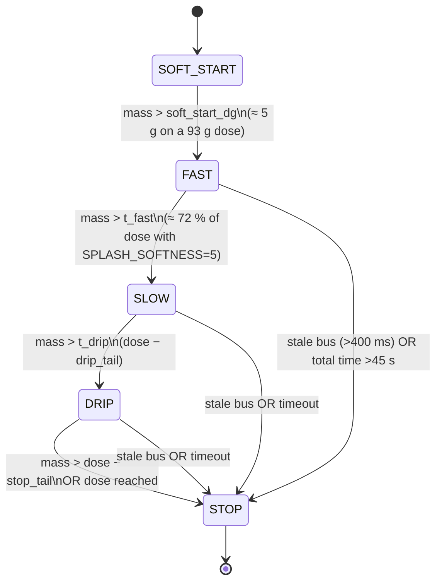

# Fill algorithm: nozzle-follows-mass, splash-aware

The deployed fill algorithm is the part of this project that moved the
production numbers. The previous system was a two-level bang-bang
(`pump on while weight < target − 10 g, pump off at target − 1.5 g`). It
worked, but it demanded a conservative dwell time per bottle to let the
splash die down, and it was unforgiving on dose consistency.

The current algorithm has four pump phases, a nozzle that physically
follows the rising liquid surface, a per-column adaptive pump speed, and a
set of safety interlocks that stop the pump the moment the bus goes
quiet. All parameters are expressed as fractions of a 93 g reference dose,
so the same tuning works for the two product doses the line runs (50 g
and 93 g).

## Primary parameters (compile-time)

From [`firmware/Core/Src/main.c:40..78`](../firmware/Core/Src/main.c), top of file:

```c
//========================================================
// НАСТРОЙКА СТАНКА
// Укажите, сколько флаконов нужно накопить перед началом розлива
#define TARGET_BOTTLES 5

// Мягкость розлива против всплесков на этикетку (крутить вручную):
//   0 : агрессивнее / быстрее, сопло чуть выше, дольше быстрый насос
//   5 : норма (старт)
//  10: мягче: сопло ближе к зеркалу, раньше замедление насоса
#define SPLASH_SOFTNESS 5
/* Скорости насоса (период импульсов в тиках TIM6-счётчика rozliv_count):
 *   rozliv=1: быстро: было >1 (каждые 2 тика); >0 = каждый тик (~×2)
 *   rozliv=3: мягкий старт (между быстрым и СТАРЫМ медленным >10)
 *   rozliv=2: финиш, ~в 1.75 раза медленнее старого (>10 → >18) */
#define ROZLIV_SOFT_PERIOD  5
#define ROZLIV_SLOW_PERIOD  18
#define ROZLIV_FAST_PERIOD  1   /* было 0 (каждый тик = опасно у горла); 1 = спокойнее */

/*
 * Пороги налиты/отлажены на режиме 93 г (REF). Для 50 г те же доли от дозы :
 * поведение как на 93, только сжатое по массе.
 */
#define REF_DOSE_DG              930  /* ves=93 → дециграммы */
#define SOFT_START_DG_93         50   /* ~5 г мягкий насос */
#define FILL_ARM_DG_93           100  /* ~10 г: старт флага у дна */
#define LIFT_FOLLOW_START_DG_93  310  /* ~31 г: начало подъёма сопла */
#define DRIP_TAIL_DG_93          20   /* запас до капельного стопа */
#define STOP_TAIL_DG_93          35   /* жёсткий стоп до цели */

/*
 * Высота сопла (как на учебном стенде, НЕ через «offset»):
 * 1) пока масса мала: сопло СИДИТ у низа (spusk), пока зеркало не подойдёт;
 * 2) затем поднимается пропорционально массе, но только на долю хода.
 * NOZZLE_RISE_PERMILLE: основной зазор (от 350): 635 ≈ ещё чуть больше после 580.
 * К концу дозы: доподъём (NOZZLE_END_*).
 */
#define NOZZLE_RISE_PERMILLE      635
#define NOZZLE_END_START_PERMILLE 850  /* с ~85% дозы: доподъём */
#define NOZZLE_END_RISE_PERMILLE  980  /* финиш: почти полный ход вверх */
//========================================================
```

Everything scales from the 93 g reference. For a 50 g dose, `dose_dg` becomes
500 and every threshold shrinks proportionally: the shape of the pump
profile and the nozzle trajectory stays identical.

## Pump phase diagram



Phase meanings:

| Phase | `rozliv` value | Pump pulse period (TIM6 ticks) | Purpose |
|---|---|---|---|
| SOFT_START | 3 | `ROZLIV_SOFT_PERIOD = 5` | prime the hose at the bottom of the bottle, no splash |
| FAST | 1 | `ROZLIV_FAST_PERIOD = 1` | bulk-fill the body of the bottle |
| SLOW | 2 | `ROZLIV_SLOW_PERIOD = 18` | close the gap to target without overshoot |
| DRIP | 2→0 | tail-off | last few milligrams and shutoff |
| STOP | 0 |: | pump pulses disabled, column waits for next bottle |

The `SPLASH_SOFTNESS` dial shifts the FAST→SLOW cross-over earlier (softer)
or later (more aggressive). It is kept as a single knob so plant operators
could tune the trade-off between throughput and splash on the bottle neck
without rebuilding firmware.

## Nozzle-follows-mass

The nozzle tip starts at `spusk` (deep inside the bottle neck) and stays
there while the first ~30 g lands at the bottom. Only once the liquid surface
is high enough that free-fall splash would reach the neck does the nozzle
start rising, in proportion to the measured mass:

```c
if (vesy_i <= lift_start_dg) {
    *updown = 3;
    *ss2_i = spusk;                         /* stay at the bottom */
} else {
    m_prog     = vesy_i - lift_start_dg;    /* mass accumulated since lift point */
    m_range    = dose_dg - lift_start_dg;   /* mass remaining in the lift zone */
    rise_range = (fill_range * NOZZLE_RISE_PERMILLE) / 1000;
    target_d   = spusk - (m_prog * rise_range) / m_range;
    ...
}
```

Past 85 % of dose (`NOZZLE_END_START_PERMILLE 850`), there is an extra lift
step up to 98 % of travel so the nozzle clears the neck in time for the
drum rotation to the next column.

Net effect: the free-fall distance from the nozzle tip to the liquid
surface stays within a few millimetres throughout the entire fill, which is
what killed splash in practice.

## Adaptive pump speed per column

Each column has its own actual flow (pumps, hoses, nozzle aperture; they
all drift). The firmware observes the mass delta between two Modbus sweeps
and adjusts a per-column speed selector `ss[i]`:

```c
void calculate_speeds(void) {
  for (int i = 0; i < 5; i++) {
    av3[i] = av[i] - av2[i];                /* mass change in this sweep */
    if (av3[i] <  5)                 ss[i] = 11;   /* really slow: bump it up */
    if (av3[i] >= 5  && av3[i] < 10) ss[i] = 6;
    if (av3[i] >= 10 && av3[i] < 20) ss[i] = 5;
    if (av3[i] >= 20)                ss[i] = 4;    /* already very fast: hold back */
    av2[i] = av[i];
  }
}
```

This is a 1-tick-latency closed loop: without it, the slowest column
dictates cycle time because the master waits for every bottle to reach dose
before advancing the drum.

## Safety interlocks

These run before the "normal" fill decisions on every tick:

1. **Dose latch (`fill_dose_hit[ch]`)**: once a column has reached dose
   this cycle, the pump cannot restart on this bottle. Even if the mass
   reading momentarily sags (e.g. a splash drop ran off the load cell),
   the pump stays off.
2. **Stale scale (`FILL_SCALE_STALE_MS = 400 ms`)**: if a column's weight
   has not been refreshed by Modbus within 400 ms, that column's pulses
   are paused. We stop filling blind. The other four columns keep running.
3. **Overall timeout (`FILL_MAX_MS = 45 s`)**: nothing in a 5-column
   cycle should take 45 s. If it does, the whole fill is aborted.
4. **Mechanical pre-arm (`fill_arm_dg` and `d > spusk − 10`)**: the pump
   does not start until the mass has already risen a little (the nozzle is
   actually in the bottle) AND the nozzle axis is near the down end-stop.
   This catches the "nozzle up but tare command fired" race seen during
   field debugging.

## Why this moved the throughput numbers

The old bang-bang needed to wait after shutoff for the splash to settle
before the drum could rotate. Otherwise liquid left on the bottle neck
would be dragged under the next nozzle and misread. The new algorithm cuts
most of that wait, because:

- the nozzle is near the surface when the pump stops, so there is no
  free-fall column of liquid to splash;
- the DRIP phase has already slowed the flow to near-zero before the hard
  stop, so there is no overshoot settling;
- the adaptive speed makes all five columns finish within a tighter window,
  so the drum doesn't wait on the slowest one.

Result on the line (operator-reported):

- Throughput: **480 → 650 bottles / hour (+35 %)**.
- Overfill rejects: visibly down (no quantitative pre/post count available;
  operators do a daily reject check, not per-cycle logging).
- Headroom: the current timing still has conservative post-fill delays
  specifically to kill splash on the bottle label. The firmware can run
  faster; the mechanical and surface-tension limits are now the ceiling.
