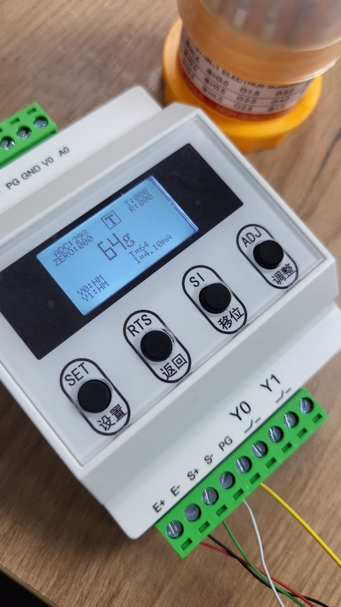

# The 2021 system: a textual "before" picture

This project is a modernization of an existing production machine. The
mechanics (drum, nozzle axes, peristaltic pumps, load cells) and the
stepper carrier board with the Darlington array were all designed and
built in 2021 by the previous engineer. He kindly shared his sources and
schematics with me for reference while I did the retrofit.

**None of the previous engineer's code, schematics or Gerbers are
reproduced in this repository.** The description below is written from
memory, from reading his sources locally, and from operating the deployed
machine. It describes architecture and limitations, not his design files.

## Two boards, one serial link

The 2021 system had two custom STM32 PCBs:

- **BRD1: weighing board (STM32F1).** Five HX711 24-bit ADC bridge
  front-ends, one per load cell. CLK/DATA pairs bit-banged in software
  from GPIO; a 16×2 I²C LCD and three buttons on the board itself; local
  calibration data stored in the MCU's internal flash. BRD1 published the
  computed weights to BRD2 over a dedicated ribbon cable.

- **BRD2: stepper board (STM32F4).** One MCU driving every motor through
  a Darlington array into industrial step/dir drivers: the drum stepper,
  five nozzle vertical axes, five peristaltic pump axes. All application
  logic ran inside a single TIM6 interrupt at ~10 kHz: motor pulses, I/O
  reads, bottle counting, pump control, incoming-weight handling.

## Why BRD1 was the bottleneck

The HX711 is a cheap part. Reading it in software is slow by design:

- the chip signals "data ready" by pulling DATA low; the MCU must wait for
  that edge (busy-wait on the GPIO);
- the MCU must then clock out 24 bits with microsecond-scale pulses on CLK;
- a fifth channel means a fifth sequential busy-wait + bit-shift pass per
  main-loop iteration.

The result: effective aggregate sample rate for five sensors sat in the
single-digit Hz range on BRD1, and nothing else on BRD1 could run while
those busy-waits were spinning. Calibration coefficients had to be set
on a 16×2 LCD inside the machine enclosure with three buttons: the plant
operator was never going to touch that, so re-calibration was always a
service visit.

## Why BRD2 was the bottleneck

Every motion decision was inside one TIM6 ISR:

- drum stepping, nozzle up/down for all five columns, pump pulses for all
  five columns, bottle-presence inputs, mark sensor polling, control inputs,
  all competing in the same 10 kHz slot;
- there was no way to add a non-trivial sensing path (like a non-blocking
  bus master) without visibly hurting drum motion;
- any `HAL_Delay` in a corner of the code would stop everything.

In production this manifested as drum jitter when a particular code path
fired, visible mostly at corners of the cycle (bottle hand-off between
drum positions).

## What was replaced

Everything on the sensing side:

- BRD1 as a whole was removed from the installed machine. The HX711s, the
  16×2 LCD, the on-board calibration menu. All gone.
- Five standalone QLST industrial weighing indicators took over.
  Each has its own ADC, its own filter, its own display and its own
  calibration buttons (visible in the photo above). The operator can
  re-calibrate any channel on the panel of the indicator. No enclosure
  to open.
- The ribbon cable from BRD1 to BRD2 was replaced by my
  [RS-485↔UART shield](shield.md), plugged into the exact same connector
  on BRD2.
- The weighing data path became a Modbus RTU bus (see
  [`modbus.md`](modbus.md)).

What was kept:

- The mechanical frame, drum, nozzle axes, pumps, load cells.
- BRD2 (the stepper carrier board), unmodified.
- The industrial step/dir drivers and the Darlington array on BRD2.

What was rewritten in BRD2's firmware:

- The giant TIM6 ISR was split up: motion stays in TIM6, the drum
  position event moved to its own EXTI line, the Modbus master became a
  non-blocking state machine running from the main loop, USB CDC replaced
  the long UART run to the Raspberry Pi HMI.
- The two-level bang-bang fill control was replaced by a four-phase
  pump profile with a nozzle that physically tracks the rising liquid
  surface, plus per-column adaptive pump speed. See
  [`fill-algorithm.md`](fill-algorithm.md).
- Safety interlocks were added: stale-sensor pause, dose latch, overall
  fill timeout.

## Why describe "before" at all

Because the number that matters is the delta (480 → 650 bottles / hour,
plus the operator-serviceable calibration), and the delta is only honest
if the "before" is described honestly. Readers who come from a brownfield
industrial background recognise this picture instantly; readers who do
not can see what kind of legacy constraints shape the work.
