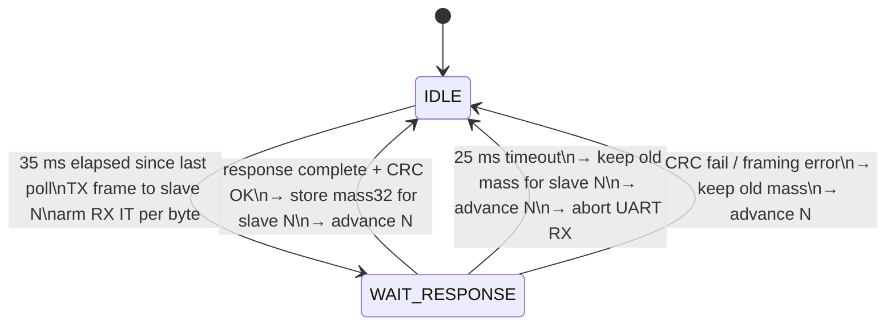

# Modbus RTU master to the QLST weighing bus

The five load cells are now read through five industrial weighing indicators
(QLST series) on a single RS-485 bus. The stepper MCU is the Modbus RTU master.
This document describes the register map used, the on-wire frames, the master
state machine and the error handling.

## Bus configuration

| Parameter | Value |
|---|---|
| Physical layer | RS-485, 2-wire + GND, 1 bus (via my adapter shield) |
| Baud rate | 115 200 |
| Framing | 8N1 |
| Slave addresses | 1, 2, 3, 4, 5 (one per column) |
| Transceiver on master side | MAX485-class module on the shield |
| MCU UART | USART2, PA2 (TX) / PA3 (RX), driven by `HAL_UART_Transmit` + `HAL_UART_Receive_IT` |

The baud rate was raised from the shipped default to 115 200 as part of the
field work when a 5th column was added: see
[`field-notes.md`](field-notes.md).

## QLST register map used by this firmware

The vendor manual (`QLST_User_manual_V1.0_EN.pdf`, not redistributed here) is
the authoritative reference. The subset actually touched by this firmware:

| Address | Access | Length | Meaning | Notes |
|---|---|---|---|---|
| 0x0000 | R (0x03) | 2 regs (32-bit signed) | Real-time weight (gross or net depending on peel state) | Low word at addr 0, high word at addr 1. Units: 0.1 g (deci-grams) on this configuration. |
| 0x0011 | W (0x06) | 1 reg | Peel command: value `1` zeroes current reading (net mode), value `2` cancels peeling (back to gross) | **Safe**: does NOT touch calibration in EEPROM. |
| 0x0012 | W (0x06) | 1 reg | Zero calibration: overwrites the stored zero in EEPROM | **Do NOT use at runtime** (see field notes). |

Direct code reference: [`firmware/Core/Src/main.c:714..720`](../firmware/Core/Src/main.c):

```c
/* Было опасно: 0x12=1 = ZERO CALIBRATION (портит калибровку в EEPROM).
 * Нужно оператору: обнулить показания (peeling), как в мануале QLST:
 *   01 06 00 11 00 01 : write 1 to reg 17
uint8_t request[8] = {0x00, 0x06, 0x00, 0x12, 0x00, 0x01, 0x00, 0x00};
 */
uint8_t request[8] = {0x00, 0x06, 0x00, 0x11, 0x00, 0x01, 0x00, 0x00};
```

The commented-out line is the mistake that was fixed during field debugging.
See [`field-notes.md`](field-notes.md) for how it manifested.

## On-wire frames

### Weight read (poll)

Request to each slave:

```
+--------+------+-----------+-----------+-----------+
| 0x0N   | 0x03 | 0x00 0x00 | 0x00 0x02 | CRC lo hi |
+--------+------+-----------+-----------+-----------+
   addr   func    start      count         CRC-16
```

Response (8 bytes):

```
+--------+------+------+-------+-------+-----------+
| 0x0N   | 0x03 | 0x04 | reg0  | reg1  | CRC lo hi |
+--------+------+------+-------+-------+-----------+
   addr   func   bytes  low wd  hi wd    CRC-16
```

Decoding the 32-bit signed weight, straight from the firmware
([`firmware/Core/Src/main.c:403..408`](../firmware/Core/Src/main.c)):

```c
uint16_t lo = ((uint16_t)rs485_rx_buffer[3] << 8) | rs485_rx_buffer[4];
uint16_t hi = ((uint16_t)rs485_rx_buffer[5] << 8) | rs485_rx_buffer[6];
int32_t  mass32 = (int32_t)(((uint32_t)hi << 16) | (uint32_t)lo);
av[current_sensor_index] = (int)mass32;   /* units: 0.1 g */
```

Note the word order: within each 16-bit register the byte order is big-endian
(as Modbus requires), but the two registers themselves are low-word-first.
This matches the vendor's own worked example in the manual (reg 0x0000
= 0x04D2, reg 0x0001 = 0x0000 → decimal 1234).

### Peel / cancel peel (operator tare and fill-cycle framing)

```c
/* Peel active slaves (zero current gross for a clean net reading) */
tx: 0x0N 0x06 0x00 0x11 0x00 0x01 CRC
rx: echo of request

/* Cancel peel (back to gross reading) */
tx: 0x0N 0x06 0x00 0x11 0x00 0x02 CRC
```

The peel command is used in two situations:

1. **Operator tare.** A hardware tare button is wired to `PC2`. On a 2-second
   hold the firmware peels all five scales (one tare per press, debounced so
   a stuck button cannot fire repeatedly).
2. **Before every fill cycle.** `set_tare_active_scales()` peels the scales
   that are about to be filled, waits ~1 s while continuing to poll Modbus so
   the readings do not go stale, then starts the fill. After the fill,
   `cancel_tare_all_scales()` restores gross mode.

Writing to register 0x0012 would also "zero" the indicator, but it does so
by rewriting the EEPROM-stored zero calibration constant. That is a
one-time factory procedure, not a runtime tare, and firing it on every bottle
destroys the calibration. See `tare_all_scales()` in `main.c` for the
annotated code comment.

## Master state machine

Non-blocking, driven from the main loop:



Timing constants from the firmware ([`firmware/Core/Src/main.c:225..229`](../firmware/Core/Src/main.c)):

```c
#define POLL_PERIOD_MS       35    /* minimum gap between poll frames */
#define RESPONSE_TIMEOUT_MS  25    /* give up on this slave, go next */
#define FILL_SCALE_STALE_MS  400   /* if a slave has not answered for this long,
                                      pause its pump pulses (do not block cycle) */
#define FILL_MAX_MS          45000 /* hard abort of the whole fill */
```

Cycle math: 5 slaves × 35 ms = **~175 ms per full bus sweep ≈ 5.7 Hz per
sensor**. The QLST filters internally at a higher rate; this master-side
rate is set by what the fill algorithm actually needs to see the mass change
with low jitter, not by the sensor bandwidth.

## Error handling

- **Response timeout**: one bad slave does not stall the master. The master
  aborts the UART RX, advances `current_sensor_index`, and moves on.
- **CRC fail / framing / overrun**: same policy. UART error flags
  (`__HAL_UART_CLEAR_OREFLAG/NEFLAG/FEFLAG`) are cleared before every TX so
  one glitch does not poison the next frame.
- **Stale data in the fill loop**: if a column's last-successful-response
  timestamp is older than `FILL_SCALE_STALE_MS`, that column's pump pulses
  are paused until a fresh sample arrives. The other four columns keep
  running.
- **Overall fill timeout**: if the entire fill cycle takes longer than
  `FILL_MAX_MS`, the fill is force-stopped. This catches pathological
  conditions (empty tank, clogged nozzle, dead indicator) without flooding
  the bottle.

## Why a software state machine instead of a thread or RTOS

The whole fill controller is bare-metal. The TIM6 ISR owns the motion tick,
the main loop owns Modbus and the fill algorithm, USB CDC runs from its own
IRQ with a background poll piggy-backed on TIM6. A state machine is the right
tool because:

- the budget per bus transaction (~60 ms worst case) is far larger than any
  motion-critical deadline (steppers are stepped from TIM6 at 10 kHz);
- there is no blocking wait that needs a thread to hide;
- adding an RTOS would add context-switch jitter to the stepper tick, which
  is exactly the signal that must be jitter-free for the drum to seat
  bottles cleanly.

For a next revision this could be made cleaner with proper NVIC priority
grouping (TIM6 at a strictly higher preemption priority than USART2 RX),
but the current configuration works and the state machine makes any
interaction trivially analysable.
